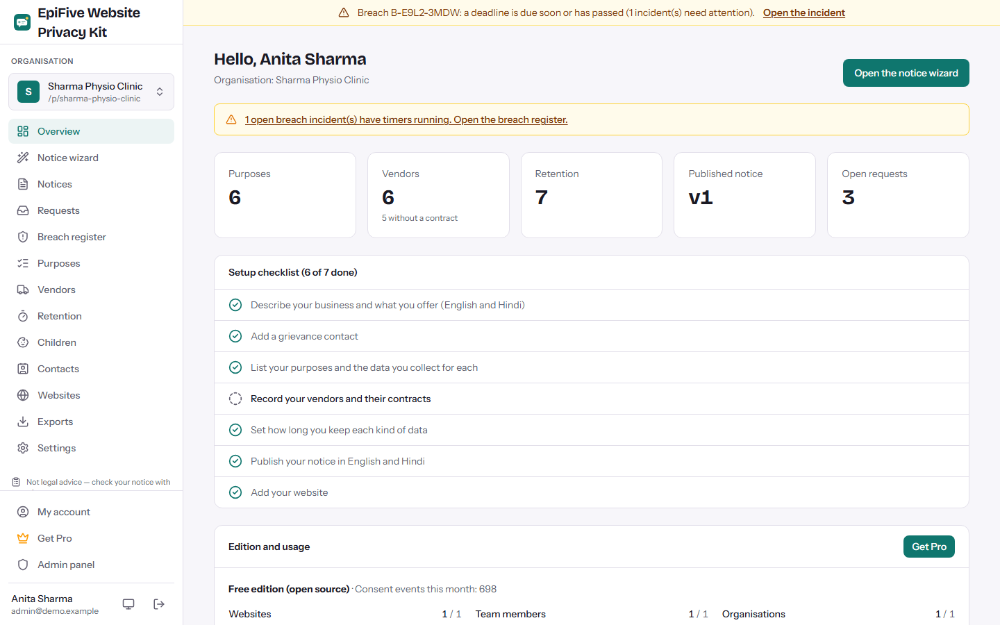
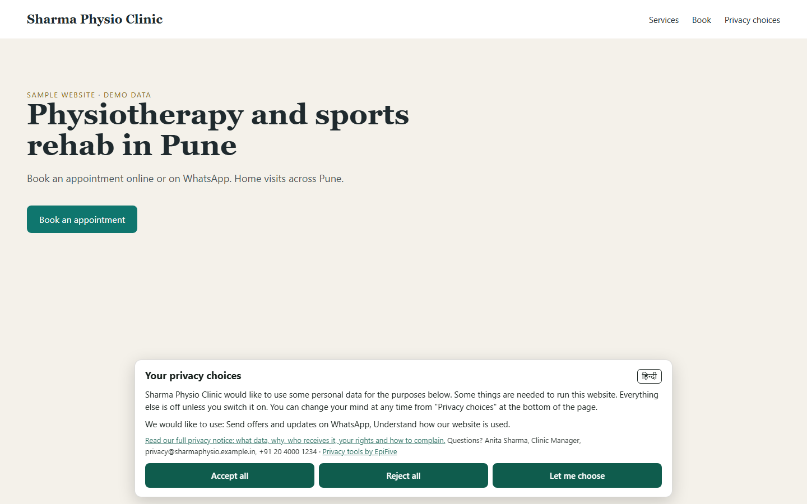
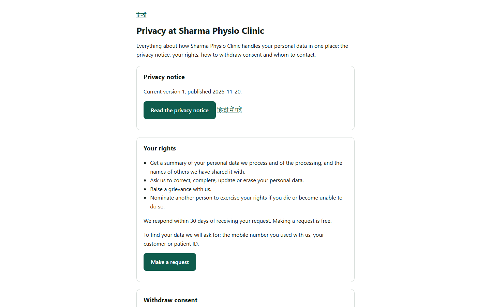
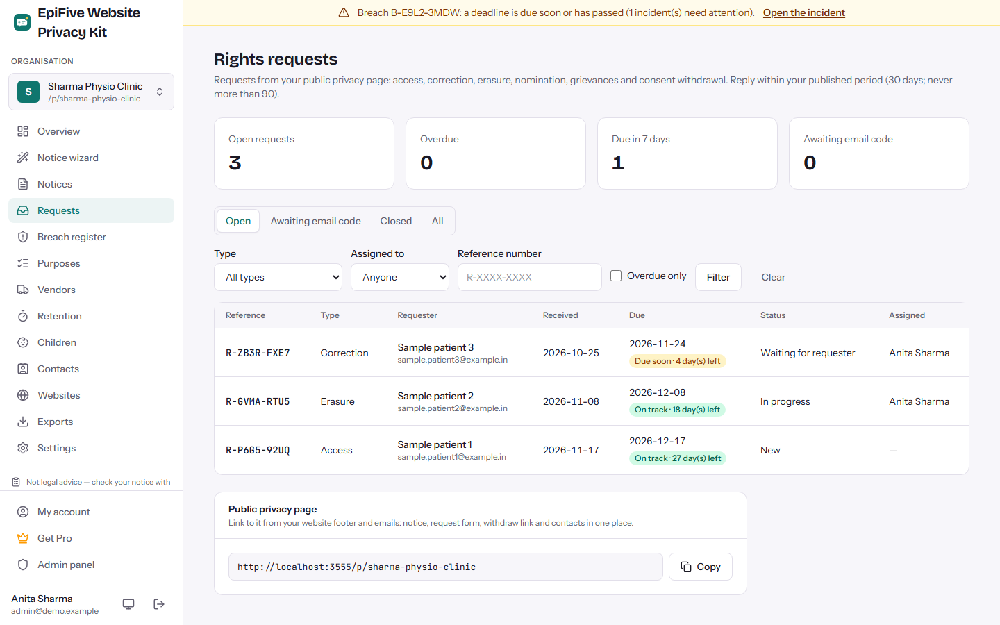
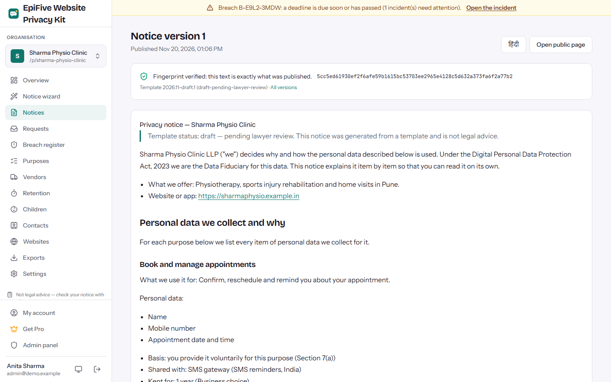
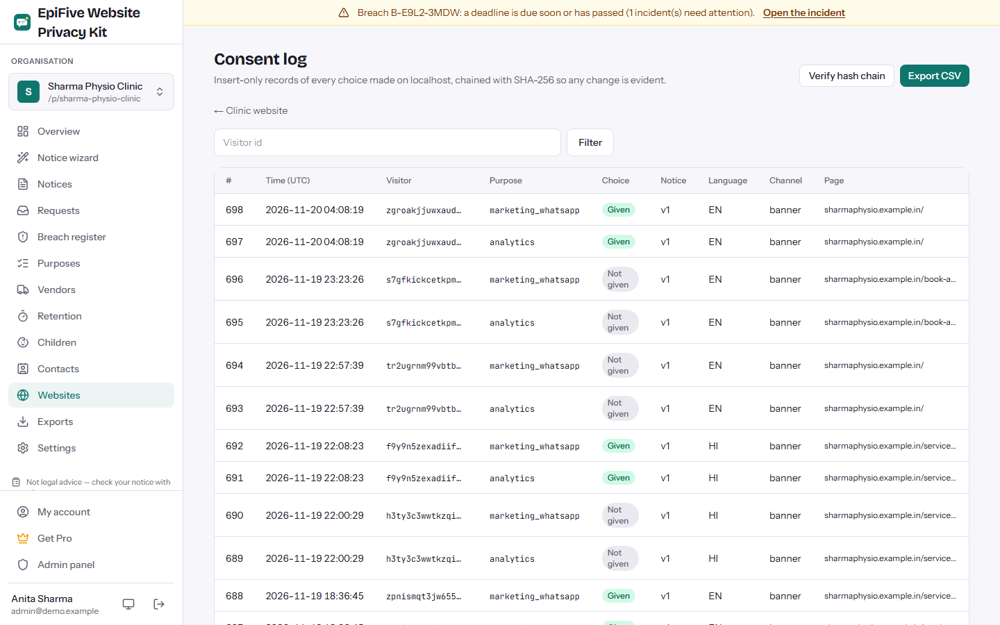
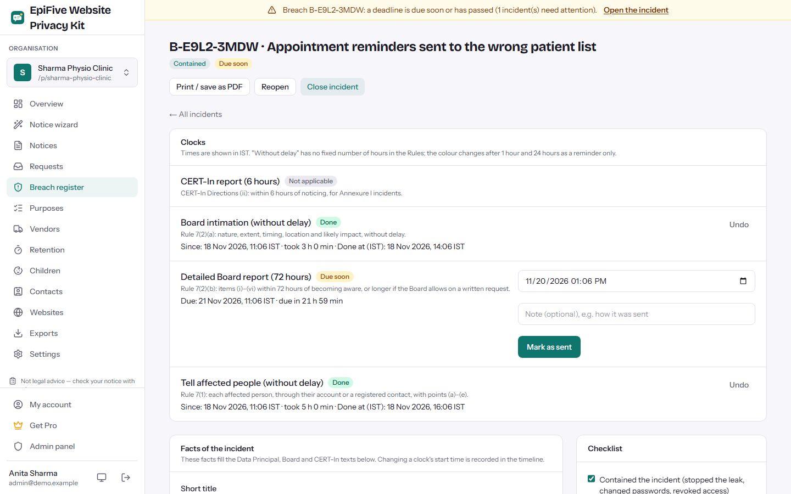

# EpiFive Website Privacy Kit

<!-- epifive:header -->
> A self-hosted DPDP toolkit for Indian websites: privacy notices, a consent banner, consent records and a rights-request inbox.

[](LICENSE)
[](https://github.com/epifive/website-privacy-kit/releases/latest)
[](https://github.com/epifive/website-privacy-kit/stargazers)

**[Docs & guide on epifive.com](https://www.epifive.com/blog/website-privacy-kit-open-source-dpdp-consent-banner?utm_source=github&utm_medium=readme&utm_campaign=website-privacy-kit)** · **[Download the latest release](https://github.com/epifive/website-privacy-kit/releases/latest)** · [Pro edition](https://www.epifive.com/products/website-privacy-kit-pro?utm_source=github&utm_medium=readme&utm_campaign=website-privacy-kit)

**Open-source DPDP toolkit for Indian websites: privacy notices in English and Hindi, a purpose-wise
consent banner, consent records with a hash chain, a privacy hub with a rights-request inbox, a breach
register with timers and a retention schedule.** Self-hosted. Built with Next.js 16, React 19 and
Tailwind CSS 4, with SQLite by default (MySQL 8 optional).

> **Not legal advice.** This is software that helps you organise DPDP Act 2023 / DPDP Rules 2025 tasks.
> It does not make you compliant on its own and is not a substitute for a lawyer. You (the business)
> are the Data Fiduciary. All legal texts and templates are **drafts pending lawyer review**.
> EpiFive is **not a Consent Manager** registered with the Data Protection Board of India, and this
> software does not act as one.

**Live demo:** there is no public demo server yet. Run it locally with sample data in a few minutes
(see [Demo data](#demo-data)), or look at the screenshots below.



| Consent banner on a website | Privacy hub | Rights requests inbox |
| --- | --- | --- |
|  |  |  |
| **Notice (EN/HI, fingerprinted)** | **Consent log with hash chain** | **Breach register with timers** |
|  |  |  |

More in [`screenshots/`](screenshots) (home page, readiness checker, dark mode, mobile request form).

## Features

- **Notice generator (English + Hindi):** a questionnaire with sector presets (clinic, coaching
  centre, online store, agent, CA firm) produces an itemised notice per purpose, the banner text, a
  legacy-customer message and the grievance-contact block. Every publish is an immutable version
  with a SHA-256 fingerprint per language.
- **Consent banner (`w.js`, about 7 KB gzip):** Accept all / Reject all / Choose with equal weight,
  nothing pre-ticked, a preference centre, EN/HI switch, script gating
  (`<script type="text/plain" data-wpk-purpose="analytics">`), Google Consent Mode v2 mapping,
  `wpk.form()` for unticked consent checkboxes on your forms, Shadow DOM, strict-CSP friendly.
- **Consent records:** append-only events (grant, deny, withdraw) with notice version, language,
  channel and page, pseudonymous subject ids, a per-site hash chain with a "Verify chain" button,
  database triggers that refuse edits, and a retention purge that leaves a checkpoint.
- **Privacy hub (`/p/<your-org>`):** notice, grievance contact, withdraw page and a rights-request
  form (access, correction, erasure, nomination, grievance) with email-code verification and
  optional Cloudflare Turnstile.
- **Rights inbox:** due dates and SLA colours (30 days by default, never above 90), assignment,
  notes, EN/HI reply templates with your Rule 9 contact, attachments encrypted at rest, reminders.
- **Breach register:** CERT-In 6-hour, Board "without delay" and 72-hour clocks, Rule 7 texts in
  English and Hindi, recipients list, evidence timeline and a print-ready Board report.
- **Retention schedule:** categories with law references, periodic and request erasure tasks with
  sign-off, optional pre-erasure notice and a one-year floor for logs.
- **Vendor (processor) register**, **children mode** (age gate: an under-18 visitor's choices are
  not recorded and tracking can never be switched on), **CSV exports** of every register and a
  **JSON proof export** (notice hashes + chain verification).
- **Public tools:** DPDP readiness checker (28 questions, EN/HI, answers never leave the browser),
  a free notice generator and 13 plain-language guides with official citations.
- **Security:** argon2id passwords, TOTP two-step verification (QR code) required for the
  administrator, envelope encryption with a master key, CSRF and strict nonce CSP, rate limits,
  insert-only audit and security logs.
- **No trackers.** The app makes no third-party calls (unless you turn on Cloudflare Turnstile for the
  request form), and your data stays on your server.

## Free vs Pro

| | Free (this repo, MIT) | Pro (one-time licence) |
| --- | --- | --- |
| Notice generator EN/HI, banner, consent log + hash chain, privacy hub, rights inbox, breach register, retention, vendor register, readiness checker, guides | ✓ | ✓ |
| Organisations / websites / users | 1 / 1 / 1 | Unlimited, with team roles (owner, admin, viewer) |
| Children | Age gate | Age gate + verifiable parental-consent flow (Rule 10) |
| Exports | CSV + JSON proof | + evidence pack ZIP with SHA-256 manifest, print-to-PDF registers |
| REST API and signed webhooks | – | ✓ |
| White-label banner and privacy pages | – | ✓ |
| Sector template packs (gym, restaurant, salon, travel agency, hotel, NGO) | – | ✓ |
| Updates and support | Community (GitHub issues) | 1 year of priority updates and support |
| Price | ₹0 | ₹3,499 / $59 (agency licence for client work: ₹9,999) |

**Get Pro:** https://www.epifive.com/products/website-privacy-kit-pro · **Hosted plans coming soon.**

## Quick start

**Requirements:** Node.js 24.7 or newer (built-in SQLite and argon2id), about 2 GB of free memory
for the first build.

```bash
git clone https://github.com/epifive/website-privacy-kit.git
cd website-privacy-kit
npm install
npm run setup     # writes .env.local with a new master key and job secrets
npm start         # builds once (a few minutes), then serves http://localhost:3000
```

Open http://localhost:3000. The web installer asks for the database (**SQLite**: nothing to set up;
**MySQL 8**: host, database, user, password) and creates your administrator account. Sign in, set up
two-step verification (scan the QR code with any authenticator app), then follow the setup wizard
in the dashboard: business details, contacts, purposes, rights settings, publish the notice and add
your website.

**Copy `WPK_MASTER_KEY` from `.env.local` into your password manager.** It unlocks the encrypted
contact details and attachments; never store it with your database backups.

### Add the banner to your website

Dashboard → Websites → your site shows the snippet:

```html
<script src="https://privacy.example.com/w.js" data-site="pk_live_..." async></script>
```

Mark optional scripts so they wait for consent:

```html
<script type="text/plain" data-wpk-purpose="analytics" src="https://www.googletagmanager.com/gtag/js?id=G-XXXX"></script>
```

A "Privacy choices" link: any element with `data-wpk-open`. JavaScript API: `wpk.open()`,
`wpk.get()`, `wpk.on("change", fn)`, `wpk.form(formEl, { purposes: ["marketing_email"], subject: "email" })`,
`wpk.withdrawAll()`. WordPress users can use the companion plugin
[website-privacy-kit-wp](https://github.com/epifive/website-privacy-kit-wp).

## Deploy

### Docker

```bash
npm run setup                    # or create .env.local yourself (see .env.example)
docker compose up -d --build     # app on port 3000, SQLite in the "storage" volume
# MySQL instead of SQLite:
docker compose -f docker-compose.yml -f docker-compose.mysql.yml up -d --build
```

### Any Linux server (VPS)

`npm ci && npm run build`, then run `npm start` (or `node server.js`) under systemd or PM2 behind
Caddy or Nginx with HTTPS, and set `SITE_URL=https://your-domain`. Session cookies are `Secure` in
production: use HTTPS (for a plain-HTTP test on your LAN only, set `WPK_INSECURE_COOKIES=1`).

### Scheduled jobs and email

Reminders (rights due dates, breach timers, erasure tasks, the daily chain digest) run when a cron
job calls `/api/v1/cron/run` every 15 minutes with `CRON_SECRET`; see [`scripts/cron.md`](scripts/cron.md).
Email goes through any SMTP server (Admin → Settings → Email; Amazon SES, Zoho, Gmail, your host).
Without SMTP, the email-code step of the rights form cannot work.

### Backups

[`scripts/backup.sh`](scripts/backup.sh) makes an encrypted nightly backup (database + storage
folder, encrypted with [age](https://age-encryption.org)). Keep the master key separately.

## Demo data

```bash
# .env.local (after npm run setup), then npm start and run the installer with SQLite:
DEMO_SEED=true
```

With `DEMO_SEED=true` an empty database gets a sample clinic for the administrator: a website, a
published EN/HI notice, four rights requests, a breach incident and 45 days of consent records.
All names and addresses are fake. `DEMO_MODE=true` makes the dashboard read-only (public demos).

## Development

| Command | What it does |
| --- | --- |
| `npm run dev` | Widget build + `next dev` |
| `npm run build` | Widget build (10 KB gzip budget) + `next build` |
| `npm test` | Unit tests (Vitest, one worker) |
| `npm run test:e2e` | Browser tests (headless Chrome over CDP) against the production build |
| `npm run lint` / `npm run typecheck` | ESLint / TypeScript |

Layout: `src/core/` (pure domain logic: legal templates, notice renderer, presets, hash chain),
`src/lib/` (database, services, security), `src/app/` (dashboard, admin, privacy hub, public tools,
widget API), `src/widget/runtime/` (the banner), `content/` (guides and the readiness question bank),
`languages/hi.json` (Hindi interface pack). Tests cite the requirement IDs in
[`docs/REQUIREMENTS.md`](docs/REQUIREMENTS.md).

## Contributing

Bug reports and pull requests are welcome: please open an
[issue](https://github.com/epifive/website-privacy-kit/issues) first for larger changes, and run
`npm run lint`, `npm test` and `npm run build` before sending a PR. Wording rules: say "helps you
meet DPDP requirements", never "compliant", "certified" or "guaranteed", and never call this
software a Consent Manager.

## More from EpiFive

- Pro edition: https://www.epifive.com/products/website-privacy-kit-pro
- More open-source projects: https://www.epifive.com/open-source
- Custom setup or development: https://www.epifive.com/services#custom-app-development

## Licence

[MIT](LICENSE) © 2026 EpiFive

---

<p align="center">Made by <b>EpiFive</b> — <a href="https://www.epifive.com/?utm_source=github&utm_medium=readme&utm_campaign=website-privacy-kit">www.epifive.com</a> · <a href="https://www.epifive.com/open-source?utm_source=github&utm_medium=readme&utm_campaign=website-privacy-kit">more open-source projects</a></p>
